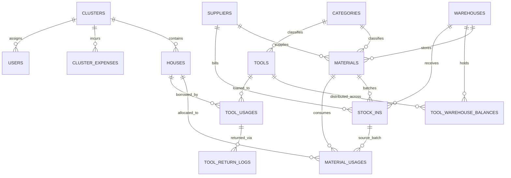

# PRODUCT REQUIREMENTS DOCUMENT (PRD) & SYSTEM SPECIFICATION
## System: Construction Logistics & Housing Cost Management Portal (D'Royal Village)
**Target Reader:** Autonomous AI Coding Agent / Senior Fullstack Engineer  
**Specification Version:** 1.1.0 (Production Blueprint + Seed Fixtures)

---

## 1. Executive Summary & Problem Domain

### 1.1 Context
In residential construction projects with multiple housing clusters (estates), managing bulk materials and reusable tools across central warehouses, transit warehouses, and individual house lots is prone to inventory leakage, unaccounted breakages, untracked subcontractor costs, and budget overruns.

### 1.2 System Purpose
An enterprise-grade, field-tested web portal to:
1. **Track Material Inflow & Batch Provenance:** Every arrival is a discrete batch with purchase price, supplier, warehouse, proof of delivery, and remaining quantity.
2. **Direct House Allocation:** Materials are issued directly to specific houses, immediately updating individual house project construction costs.
3. **Tool Circulation & Condition Triage:** Heavy/light tools are loaned to houses and returned with strict tri-state triage: Good, Broken, or Lost.
4. **House Construction Lifecycle & Warranty:** Houses transition from construction (`pembangunan`) to completion (`selesai`) through a strict completion gatekeeper (no active tool loans), followed by an automated 1-year maintenance warranty (`warranty_expires_at`).
5. **Project Financial Auditing:** Direct material costs, equipment rentals, subcontractor vendor services, and cluster-wide overheads are aggregated per unit and per cluster.
6. **Audit Integrity:** Zero hard-deletions for entities with transaction history; idempotent forms preventing double submissions under poor field connectivity.

---

## 2. Technology Stack & Architectural Constraints

- **Backend Framework:** PHP 8.3+ with Laravel 13.x (or 11.x/12.x compatible)
- **Frontend / Fullstack Layer:** Livewire 4 (or 3.x) paired with Blade and Flux UI 2.9 (Tailwind CSS)
- **Database:** MySQL 8.0+ (InnoDB, strict mode, decimal precision for stock and currency, foreign keys with referential constraints)
- **Authentication & Security:** Laravel Fortify (with 2FA capability), Laravel Jetstream, Google OAuth via Laravel Socialite (whitelisted email domain/access)
- **Role & Permission Engine:** `spatie/laravel-permission`
- **Spreadsheet / Reporting:** `maatwebsite/excel` for Excel exports/imports
- **Testing Framework:** Pest PHP 4.x / PHPUnit with isolated test database (`logistik_test`)

---

## 3. User Roles & Access Control Matrix (RBAC)

### 3.1 Roles
1. **Admin (`admin`):** Full system access. Cross-cluster oversight, user administration, system playground/maintenance, inventory overrides.
2. **Keuangan (`keuangan` / Finance):** Cross-cluster visibility. Inventory view, cost reporting, cluster overhead expenses, house financial audit exports. Cannot alter field inventory balances.
3. **Logistik (`logistik` / Logistics Officer):** Field operator assigned to a specific `cluster_id`. Manages warehouse stock arrivals, direct allocations, tool loans/returns, inter-warehouse transfers.
4. **Pengawas (`pengawas` / Field Supervisor):** Assigned to a specific `cluster_id`. Monitors field allocations, inspects house progress, can initiate house completion and tool return verifications.

### 3.2 Permission Table
| Permission | Admin | Keuangan | Logistik | Pengawas |
|---|:---:|:---:|:---:|:---:|
| `view dashboard` | ✅ | ✅ | ✅ | ✅ |
| `view inventory` | ✅ | ✅ | ✅ | ✅ |
| `manage inventory` | ✅ | ❌ | ✅ | ✅ |
| `import inventory` | ✅ | ✅ | ✅ | ✅ |
| `view logs` | ✅ | ✅ | ✅ | ✅ |
| `manage houses` | ✅ | ❌ | ✅ | ✅ |
| `manage users` | ✅ | ❌ | ❌ | ❌ |
| `request materials` | ✅ | ❌ | ✅ | ✅ |
| `request tools` | ✅ | ❌ | ✅ | ✅ |

### 3.3 Cluster Scoping Rule
- Models with `cluster_id` (Houses, ClusterExpenses) and user scoping:
  - If `user->canAccessAllClusters()` (`admin` or `keuangan`), query all clusters.
  - If `logistik` or `pengawas`, query is scoped strictly to `user->cluster_id`.
  - Warehouses are shared or regional, but allocations must target houses in the user's assigned cluster.

---

## 4. Complete Database Schema & Entity Relationships



### 4.1 Schema DDL & Field Specifications

#### `users`
- `id`: BIGINT UNSIGNED AUTO_INCREMENT PRIMARY KEY
- `name`: VARCHAR(255) NOT NULL
- `email`: VARCHAR(255) UNIQUE NOT NULL
- `password`: VARCHAR(255) NOT NULL
- `role`: ENUM('admin', 'logistik', 'keuangan', 'pengawas', 'inactive') NOT NULL DEFAULT 'logistik'
- `cluster_id`: BIGINT UNSIGNED NULL (FK -> `clusters.id`, NULL for cross-cluster Admin/Finance)
- `two_factor_secret`, `two_factor_recovery_codes`, `two_factor_confirmed_at`: Fortify 2FA fields
- `google_id`: VARCHAR(255) NULL
- `google_linked_at`: TIMESTAMP NULL
- `timestamps`

#### `clusters`
- `id`: BIGINT UNSIGNED AUTO_INCREMENT PRIMARY KEY
- `name`: VARCHAR(255) NOT NULL (e.g., "Cluster A", "Cluster B")
- `code`: VARCHAR(50) UNIQUE NOT NULL
- `description`: TEXT NULL
- `timestamps`

#### `warehouses`
- `id`: BIGINT UNSIGNED AUTO_INCREMENT PRIMARY KEY
- `name`: VARCHAR(255) NOT NULL (e.g., "Gudang Utama", "Gudang Transit")
- `code`: VARCHAR(50) UNIQUE NOT NULL
- `location`: VARCHAR(255) NULL
- `description`: TEXT NULL
- `timestamps`

#### `categories`
- `id`: BIGINT UNSIGNED AUTO_INCREMENT PRIMARY KEY
- `name`: VARCHAR(255) NOT NULL
- `type`: ENUM('material', 'tool') NOT NULL DEFAULT 'material'
- `timestamps`

#### `suppliers`
- `id`: BIGINT UNSIGNED AUTO_INCREMENT PRIMARY KEY
- `name`: VARCHAR(255) NOT NULL
- `phone`: VARCHAR(50) NULL
- `address`: TEXT NULL
- `timestamps`

#### `houses`
- `id`: BIGINT UNSIGNED AUTO_INCREMENT PRIMARY KEY
- `cluster_id`: BIGINT UNSIGNED NOT NULL (FK -> `clusters.id`)
- `house_code`: VARCHAR(50) UNIQUE NOT NULL (Generated: `[Year]-[BlokName]`, e.g., `2026-A01`)
- `name`: VARCHAR(255) NOT NULL (e.g., "Blok A-01")
- `type`: VARCHAR(100) NOT NULL (e.g., "Tipe 36/72", "Tipe 45/90")
- `status`: ENUM('pembangunan', 'selesai') NOT NULL DEFAULT 'pembangunan'
- `start_date`: DATE NOT NULL
- `target_end_date`: DATE NULL
- `completed_at`: DATETIME NULL
- `completed_by_id`: BIGINT UNSIGNED NULL (FK -> `users.id`)
- `warranty_expires_at`: DATETIME NULL (Set to `completed_at + 1 YEAR`)
- `timestamps`

#### `materials`
- `id`: BIGINT UNSIGNED AUTO_INCREMENT PRIMARY KEY
- `warehouse_id`: BIGINT UNSIGNED NOT NULL (FK -> `warehouses.id`)
- `category_id`: BIGINT UNSIGNED NULL (FK -> `categories.id`)
- `supplier_id`: BIGINT UNSIGNED NULL (FK -> `suppliers.id`)
- `code`: VARCHAR(50) NOT NULL (Catalog code, e.g., "MAT-SMN-01")
- `name`: VARCHAR(255) NOT NULL
- `unit`: VARCHAR(50) NOT NULL (e.g., "sak", "batang", "m³", "kg")
- `unit_price`: DECIMAL(15, 2) NOT NULL DEFAULT 0.00 (Latest unit price)
- `stock`: DECIMAL(12, 2) NOT NULL DEFAULT 0.00 (Warehouse aggregate balance)
- `image`: VARCHAR(255) NULL
- `timestamps`
- Unique constraint: `UNIQUE(warehouse_id, code)` or `UNIQUE(warehouse_id, name, unit)`

#### `stock_ins` (Material Batch Receipts)
- `id`: BIGINT UNSIGNED AUTO_INCREMENT PRIMARY KEY
- `entry_code`: VARCHAR(50) UNIQUE NOT NULL (Auto-generated: `MSK-[ULID]`)
- `transaction_code`: VARCHAR(50) NULL (Formatted serial: `RCV-YYYYMMDD-XXXX`)
- `submission_key`: CHAR(36) UNIQUE NOT NULL (Client-side UUID to prevent duplicate clicks)
- `material_id`: BIGINT UNSIGNED NOT NULL (FK -> `materials.id`)
- `warehouse_id`: BIGINT UNSIGNED NOT NULL (FK -> `warehouses.id`)
- `supplier_id`: BIGINT UNSIGNED NULL (FK -> `suppliers.id`)
- `user_id`: BIGINT UNSIGNED NOT NULL (FK -> `users.id`, who recorded it)
- `quantity`: DECIMAL(12, 2) NOT NULL
- `remaining_quantity`: DECIMAL(12, 2) NOT NULL (Decrements on allocation)
- `unit_price`: DECIMAL(15, 2) NOT NULL
- `total_cost`: DECIMAL(15, 2) NOT NULL (`quantity * unit_price`)
- `date`: DATE NOT NULL (Document date)
- `received_at`: DATETIME NOT NULL (Physical arrival timestamp)
- `notes`: TEXT NULL
- `proof_image`: VARCHAR(255) NULL (Surat jalan / receipt photo)
- `timestamps`

#### `material_usages` (House Allocations)
- `id`: BIGINT UNSIGNED AUTO_INCREMENT PRIMARY KEY
- `transaction_code`: VARCHAR(50) UNIQUE NOT NULL (Format: `MAT-YYYYMMDD-XXXX`)
- `house_id`: BIGINT UNSIGNED NOT NULL (FK -> `houses.id`)
- `material_id`: BIGINT UNSIGNED NOT NULL (FK -> `materials.id`)
- `stock_in_id`: BIGINT UNSIGNED NULL (FK -> `stock_ins.id`, tracks originating batch)
- `user_id`: BIGINT UNSIGNED NOT NULL (FK -> `users.id`, creator)
- `quantity`: DECIMAL(12, 2) NOT NULL
- `unit_price_at_usage`: DECIMAL(15, 2) NOT NULL (Locked price from `stock_ins.unit_price`)
- `total_cost`: DECIMAL(15, 2) NOT NULL (`quantity * unit_price_at_usage`)
- `usage_date`: DATE NOT NULL
- `taken_by`: VARCHAR(255) NULL (Foreman / tukang receiving the items)
- `notes`: TEXT NULL
- `proof_image`: VARCHAR(255) NULL
- `voided_at`: DATETIME NULL (Soft-cancellation flag for audit trail)
- `voided_by_id`: BIGINT UNSIGNED NULL (FK -> `users.id`)
- `timestamps`

#### `tools`
- `id`: BIGINT UNSIGNED AUTO_INCREMENT PRIMARY KEY
- `category_id`: BIGINT UNSIGNED NULL (FK -> `categories.id`)
- `code`: VARCHAR(50) UNIQUE NOT NULL (e.g., "AB-001", "AT-001")
- `name`: VARCHAR(255) NOT NULL
- `unit`: VARCHAR(50) NOT NULL DEFAULT 'unit'
- `available_qty`: INT NOT NULL DEFAULT 0 (System-wide aggregate available)
- `qty_broken`: INT NOT NULL DEFAULT 0 (System-wide aggregate broken)
- `unit_price`: DECIMAL(15, 2) NOT NULL DEFAULT 0.00 (Replacement value)
- `image`: VARCHAR(255) NULL
- `timestamps`

#### `tool_warehouse_balances`
- `id`: BIGINT UNSIGNED AUTO_INCREMENT PRIMARY KEY
- `tool_id`: BIGINT UNSIGNED NOT NULL (FK -> `tools.id`)
- `warehouse_id`: BIGINT UNSIGNED NOT NULL (FK -> `warehouses.id`)
- `available_qty`: INT NOT NULL DEFAULT 0
- `qty_broken`: INT NOT NULL DEFAULT 0
- `timestamps`
- Unique constraint: `UNIQUE(tool_id, warehouse_id)`

#### `tool_usages` (Tool Loans)
- `id`: BIGINT UNSIGNED AUTO_INCREMENT PRIMARY KEY
- `transaction_code`: VARCHAR(50) UNIQUE NOT NULL (Format: `ALT-YYYYMMDD-XXXX`)
- `house_id`: BIGINT UNSIGNED NOT NULL (FK -> `houses.id`)
- `tool_id`: BIGINT UNSIGNED NOT NULL (FK -> `tools.id`)
- `warehouse_id`: BIGINT UNSIGNED NOT NULL (FK -> `warehouses.id`, source warehouse)
- `user_id`: BIGINT UNSIGNED NOT NULL (FK -> `users.id`)
- `quantity`: INT NOT NULL
- `borrow_date`: DATE NOT NULL
- `return_date`: DATE NULL (NULL = currently active loan)
- `status`: ENUM('dipinjam', 'dikembalikan', 'sebagian') NOT NULL DEFAULT 'dipinjam'
- `notes`: TEXT NULL
- `proof_image`: VARCHAR(255) NULL
- `voided_at`: DATETIME NULL
- `timestamps`

#### `tool_return_logs`
- `id`: BIGINT UNSIGNED AUTO_INCREMENT PRIMARY KEY
- `tool_usage_id`: BIGINT UNSIGNED NOT NULL (FK -> `tool_usages.id`)
- `receiving_warehouse_id`: BIGINT UNSIGNED NOT NULL (FK -> `warehouses.id`)
- `user_id`: BIGINT UNSIGNED NOT NULL (FK -> `users.id`)
- `qty_good`: INT NOT NULL DEFAULT 0
- `qty_broken`: INT NOT NULL DEFAULT 0
- `qty_lost`: INT NOT NULL DEFAULT 0
- `return_date`: DATE NOT NULL
- `notes`: TEXT NULL
- `timestamps`

#### `cluster_expenses` (Overhead & External Costs)
- `id`: BIGINT UNSIGNED AUTO_INCREMENT PRIMARY KEY
- `cluster_id`: BIGINT UNSIGNED NOT NULL (FK -> `clusters.id`)
- `house_id`: BIGINT UNSIGNED NULL (FK -> `houses.id`, if allocated directly to 1 house)
- `user_id`: BIGINT UNSIGNED NOT NULL (FK -> `users.id`)
- `type`: ENUM('rental', 'subcon_service', 'infrastructure', 'overhead', 'other') NOT NULL
- `description`: VARCHAR(255) NOT NULL
- `vendor`: VARCHAR(255) NULL
- `amount`: DECIMAL(15, 2) NOT NULL
- `start_date`: DATE NOT NULL
- `due_date`: DATE NULL
- `bill_image`: VARCHAR(255) NULL
- `notes`: TEXT NULL
- `timestamps`

#### `cluster_expense_house` (Pivot for Shared House Costs)
- `cluster_expense_id`: BIGINT UNSIGNED NOT NULL (FK -> `cluster_expenses.id`)
- `house_id`: BIGINT UNSIGNED NOT NULL (FK -> `houses.id`)
- `allocated_amount`: DECIMAL(15, 2) NOT NULL
- PRIMARY KEY (`cluster_expense_id`, `house_id`)

#### `inventory_adjustments` (Polymorphic Audit Log)
- `id`: BIGINT UNSIGNED AUTO_INCREMENT PRIMARY KEY
- `adjustable_type`: VARCHAR(255) NOT NULL (Material, StockIn, ToolWarehouseBalance)
- `adjustable_id`: BIGINT UNSIGNED NOT NULL
- `user_id`: BIGINT UNSIGNED NOT NULL (FK -> `users.id`)
- `previous_quantity`: DECIMAL(12, 2) NOT NULL
- `new_quantity`: DECIMAL(12, 2) NOT NULL
- `reason`: TEXT NOT NULL
- `timestamps`

#### `inventory_transfers` (Warehouse to Warehouse)
- `id`: BIGINT UNSIGNED AUTO_INCREMENT PRIMARY KEY
- `transfer_code`: VARCHAR(50) UNIQUE NOT NULL (Format: `TRF-YYYYMMDD-XXXX`)
- `item_type`: ENUM('material', 'tool') NOT NULL
- `material_id`: BIGINT UNSIGNED NULL (FK -> `materials.id`)
- `tool_id`: BIGINT UNSIGNED NULL (FK -> `tools.id`)
- `source_warehouse_id`: BIGINT UNSIGNED NOT NULL (FK -> `warehouses.id`)
- `destination_warehouse_id`: BIGINT UNSIGNED NOT NULL (FK -> `warehouses.id`)
- `quantity`: DECIMAL(12, 2) NOT NULL
- `user_id`: BIGINT UNSIGNED NOT NULL (FK -> `users.id`)
- `status`: ENUM('pending', 'completed', 'cancelled') NOT NULL DEFAULT 'completed'
- `notes`: TEXT NULL
- `timestamps`

---

## 5. Core Business Logic & Invariant Rules

### 5.1 Material Ingestion & Batch Lifecycle
1. **Physical Arrival Principle:** Adding or restocking a material assumes the goods are physically inside the specified warehouse.
2. **Batch Isolation:** Each arrival produces a dedicated `stock_ins` record with unique `entry_code` (`MSK-[ULID]`) and immutable historical `unit_price`. Even if a material with identical name and price exists, it creates a new arrival record.
3. **Idempotency:** Forms pass a client-generated UUID `submission_key`. If a network glitch triggers a retry, the transaction ignores duplicate keys within `DB::transaction()`.
4. **Aggregate Sync:** `materials.stock` is updated atomically (`increment`/`decrement`), mirroring the sum of unexhausted `stock_ins.remaining_quantity`.

### 5.2 Direct Material Allocation (`TransaksiLogistik`)
1. **Target Selection:** Operator selects one or multiple target houses within their cluster.
2. **Batch Depletion:** Operator selects the exact material and batch (`stock_ins`).
   - If allocating to multiple houses, total deduction = `quantity_per_house * house_count`.
   - Invariant: `total_deduction <= stock_ins.remaining_quantity`.
3. **Price Locking:** `material_usages.unit_price_at_usage` is captured directly from the chosen `stock_ins.unit_price`, guaranteeing historical cost stability regardless of future inflation.
4. **Transaction Code:** Unique formatted code `MAT-YYYYMMDD-XXXX` generated inside a database lock.
5. **Chain of Custody:** `taken_by` (recipient foreman name) and optional `proof_image` are stored.

### 5.3 Tool Lending & Tri-State Return Triage
1. **Multi-Warehouse Isolation:** Tools maintain granular balances per warehouse via `tool_warehouse_balances`.
2. **Loan Checkout:**
   - Invariant: `requested_quantity <= tool_warehouse_balances.available_qty`.
   - Atomic checkout locks balance row (`lockForUpdate()`), decrements `available_qty`, creates `tool_usages` (`status = 'dipinjam'`), and refreshes `tools.available_qty`.
3. **Return Reconciliation Formula:**
   When returning loaned tools from a house, the sum of tri-state conditions must exactly equal the returned quantity:
   $$\text{qty\_good} + \text{qty\_broken} + \text{qty\_lost} = \text{total\_returned\_qty}$$
4. **Post-Return State:**
   - `qty_good`: Increments `available_qty` in destination warehouse.
   - `qty_broken`: Increments `qty_broken` in destination warehouse (kept segregated for repair).
   - `qty_lost`: Decrements loaned balance without replenishing warehouse (can trigger loss/replacement fee).
   - If all loaned units are reconciled, `tool_usages.status = 'dikembalikan'` and `return_date = now()`. If partial, `status = 'sebagian'`.

### 5.4 House Completion & Warranty Gatekeeper
1. **Completion Prerequisite:**
   A house CANNOT be marked as complete (`selesai`) if there are active tool loans:
   $$\forall u \in \text{tool\_usages}(\text{house\_id}), \quad u.\text{return\_date} \neq \text{NULL}$$
2. **Transition Execution (`HouseFinish`):**
   - The user must reconcile all active tool loans on the house completion screen.
   - Sets `houses.status = 'selesai'`, `completed_at = now()`, `completed_by_id = auth()->id()`.
   - Automatically sets `warranty_expires_at = now() + 1 YEAR`.
3. **Allocation Lockout & Warranty Exception:**
   - Completed houses (`status = 'selesai'`) CANNOT receive new material or tool allocations, **EXCEPT** when `isUnderWarranty()` is true (`now() < warranty_expires_at`).
   - If warranty has expired, system rejects any allocation attempt (`canReceiveAllocations() === false`).

### 5.5 Financial Cost Aggregation Formulas
1. **Direct House Material Cost:**
   $$\text{Cost}_{\text{house}} = \sum_{u \in \text{material\_usages}, \text{voided\_at IS NULL}} u.\text{total\_cost}$$
2. **Cluster Direct Material Cost:**
   $$\text{Cost}_{\text{cluster\_direct}} = \sum_{h \in \text{houses}(\text{cluster\_id})} \text{Cost}_{h}$$
3. **Cluster Shared Overhead Cost:**
   $$\text{Cost}_{\text{cluster\_overhead}} = \sum_{e \in \text{cluster\_expenses}(\text{cluster\_id})} e.\text{amount}$$
4. **Grand Project Expenditure:**
   $$\text{Total Cost} = \text{Cost}_{\text{cluster\_direct}} + \text{Cost}_{\text{cluster\_overhead}}$$

### 5.6 Data Integrity & Deletion Shield
- Any `Material`, `Tool`, `House`, or `Warehouse` with existing records in `stock_ins`, `material_usages`, `tool_usages`, `inventory_adjustments`, or `inventory_transfers` CANNOT be deleted.
- Livewire UI and Model observers throw validation error: *"Tidak dapat dihapus karena memiliki riwayat transaksi operasional."*

---

## 6. Key UI Modules & Workflows

### 6.1 Screen Taxonomy
1. **`/dashboard` (Control Portal):** Real-time summary tiles (Active House Units, Registered Users, Supplier Partners, Total Cumulative Material Spend). Quick access buttons to core operations.
2. **`/transaksi` (Field Allocation Hub):**
   - **Tab 1: Alokasi Material:** Single or multi-house selection -> Material & Batch picker -> Quantity & Taken-by -> Confirmation modal -> Atomic issuance.
   - **Tab 2: Peminjaman Alat:** House selection -> Tool picker -> Source warehouse balance picker -> Quantity & notes -> Issuance.
   - **Tab 3: Pengembalian Alat:** Filter by house -> List of active tool loans -> Tri-state input (Good, Broken, Lost) -> Receiving warehouse selector -> Confirmation.
   - **Tab 4: Spreadsheet Matrix Mode:** High-speed bulk data entry table for high-volume logistics days.
   - **Tab 5: Sewa Alat & Subkon:** External rental and subcontractor billing allocated to houses or clusters.
3. **`/materials` (Material Catalog & Stock Inbound):**
   - Warehouse-filtered material list with search and category filters.
   - Direct Inbound Form / Restock Modal with proof image upload.
   - Real-time stock status badges (Aman, Menipis, Habis).
4. **`/tools` (Tool Inventory & Condition Overview):**
   - Grid/table displaying available vs broken counts per warehouse.
   - Modal to transfer tools or inspect active loan histories.
5. **`/houses` & `/houses/{house}` (House Project Monitoring):**
   - Filter by cluster, status (`pembangunan` vs `selesai`).
   - Detail view: Total accumulated material spend, bill of materials consumed, active tool loans, timeline.
   - Action: "Selesaikan Pembangunan" triggering completion gatekeeper (`/houses/{house}/finish`).
6. **`/material-log` & `/tool-log` (Audit & Movement Logs):**
   - Chronological ledger of every single stock in / out movement.
   - Multi-parameter filter (date range, type, house, supplier, search).
   - One-click Excel export with streaming download (`MaterialLogExport`).
7. **`/biaya-rumah` & `/biaya-cluster` (Financial Audits):**
   - Cost breakdown by category (Semen, Besi, Pasir, etc.).
   - Cluster overhead cost allocation engine.
8. **`/users` (Admin User Administration):**
   - Role assignment (`admin`, `logistik`, `keuangan`, `pengawas`).
   - Cluster assignment enforcement for logistics and supervisors.

---

## 7. UI/UX Design System Specification (Anti-Slop Guidelines)

### 7.1 Visual Philosophy: "Cultivated Construction Ledger"
- Clean, orderly, and calm. Dial: **ENERGY 2 / RHYTHM 1 / MOTION 1**.
- **No Generic AI Slop:** No arbitrary purple/indigo SaaS gradients, no floating decorative glass cards, no marketing buzzwords.
- Clear operational focal points: 56px comfortable table row heights, monospace tabular numerals for quantities and monetary figures.

### 7.2 Color Tokens
| Name | Hex Value | Role |
|---|---|---|
| **Linen Canvas** | `#F5F7F4` | Primary light background |
| **Paper Surface** | `#FFFFFF` | Cards, tables, forms, modals |
| **Ledger Header** | `#EBF1E8` | Table headers, calm structural dividing lines |
| **Forest Ink** | `#1A241E` | Primary typography & high-contrast data |
| **Muted Leaf** | `#486150` | Secondary metadata, field labels, helpers |
| **Structural Border**| `#D3DEC9` | Card and input dividers |
| **Leaf Green** | `#1F9B3A` | Primary actions, confirmed status, focus ring |
| **Lime Signal** | `#78C800` | Secondary emphasis / highlight tags |
| **Royal Gold** | `#D4AF37` | Exceptional financial alerts / attention badges |
| **Night Canvas** | `#090A0A` | Dark mode base |

### 7.3 Typography
- **Primary Body & Titles:** `Outfit`, sans-serif (clean, grounded, accessible).
- **Dense Labels & Navigation:** `Geist`, sans-serif.
- **Data, Codes & Currency:** System Monospace (`ui-monospace`, `Consolas`, `monospace`) with `font-variant-numeric: tabular-nums`.

### 7.4 Accessibility & Mobile Ergonomics
- Touch targets: Minimum 44px × 44px on all interactive mobile buttons and inputs.
- Multi-column forms collapse to single-column on screens `< 768px`.
- Desktop sidebar: 264px fixed; collapsible to 76px compact rail. Mobile uses top-bar navigation (56px) with drawer.

---

## 8. AI Agent Implementation Blueprint (Build Sequence)

To implement this exact system from scratch using an autonomous AI coding agent, execute these steps sequentially:

### Phase 1: Foundation & RBAC
1. Initialize Laravel 13 with Livewire 4, Tailwind CSS, and Flux UI.
2. Install `spatie/laravel-permission`, `maatwebsite/excel`, `laravel/fortify`.
3. Create migrations: `users`, `clusters`, `warehouses`, `categories`, `suppliers`, and Spatie permission tables.
4. Seed default roles (`admin`, `logistik`, `keuangan`, `pengawas`) and permissions via `PermissionSeeder`.
5. Set up cluster scoping trait and policies on User model.

### Phase 2: Core Master Data & Inventory Schemas
1. Create migrations: `houses`, `materials`, `stock_ins`, `tools`, `tool_warehouse_balances`.
2. Implement Model relationships, casts, and UUID generation (`entry_code`, `submission_key`).
3. Build `ToolInventory` support service handling concurrency locks (`lockForUpdate()`), checkouts, receipts, and aggregate recalculations.

### Phase 3: Transactional Engine
1. Create migrations: `material_usages`, `tool_usages`, `tool_return_logs`, `inventory_adjustments`, `inventory_transfers`.
2. Implement transaction code generator (`MAT-YYYYMMDD-XXXX`, `ALT-YYYYMMDD-XXXX`).
3. Build `TransaksiLogistik` Livewire component:
   - House multi-selection modal with cluster filter.
   - Batch-specific material issuance with stock validation.
   - Tool borrowing with warehouse balance validation.
   - Tool return with tri-state formula validation ($good + broken + lost = quantity$).
   - Matrix spreadsheet bulk entry mode.

### Phase 4: House Lifecycle, Warranty & Financials
1. Create migration: `cluster_expenses`, `cluster_expense_house`.
2. Implement `HouseFinish` component:
   - Check and block if active tool loans exist.
   - Tool return reconciliation form.
   - Set status `selesai` and activate 1-year warranty.
3. Build `HouseCosts` and `HouseCostDetail` components:
   - Aggregate non-voided `material_usages`.
   - Category-wise cost breakdown.
   - Excel export via `MaterialUsageExport`.

### Phase 5: UI Polish & Operational Testing
1. Apply design tokens (`#F5F7F4`, `#1F9B3A`, `#1A241E`, Outfit font, tabular numerals).
2. Configure deletion shields protecting historical records.
3. Implement `MaterialLog` and `ToolLog` with Excel exports.
4. Run comprehensive Pest test suite verifying concurrency, tri-state returns, warranty logic, and RBAC cluster isolation on MySQL.

---

## 9. Seed Data Fixtures (JSON / Seeder Ready)

The following datasets provide complete, authentic seed fixtures covering all system entities. An AI agent can convert these directly into Seeder classes or factory definitions.

### 9.1 Users & Role Fixtures
```json
[
  {
    "name": "Super Admin",
    "email": "admin@logistik.com",
    "password": "password",
    "role": "admin",
    "cluster_id": null
  },
  {
    "name": "Budi Logistik (Cluster A)",
    "email": "logistik@logistik.com",
    "password": "password",
    "role": "logistik",
    "cluster_name": "Cluster A"
  },
  {
    "name": "Siti Keuangan",
    "email": "keuangan@logistik.com",
    "password": "password",
    "role": "keuangan",
    "cluster_id": null
  },
  {
    "name": "Hendra Pengawas (Cluster B)",
    "email": "pengawas@logistik.com",
    "password": "password",
    "role": "pengawas",
    "cluster_name": "Cluster B"
  }
]
```

### 9.2 Clusters & Warehouses
```json
{
  "clusters": [
    { "name": "Cluster A", "code": "CLS-A", "description": "Tahap pembangunan sisi utara (Tipe 36 & 45)" },
    { "name": "Cluster B", "code": "CLS-B", "description": "Tahap pembangunan sisi selatan (Tipe 54 & 70)" }
  ],
  "warehouses": [
    { "name": "Gudang Utama", "code": "GDG-01", "location": "Pintu Gerbang Utama", "description": "Gudang sentral penerimaan material besar dan alat berat" },
    { "name": "Gudang Transit Sisi Utara", "code": "GDG-02", "location": "Blok A Area Lapangan", "description": "Penyimpanan sementara material cepat pakai" }
  ]
}
```

### 9.3 Categories & Suppliers
```json
{
  "categories": [
    { "name": "Semen", "type": "material" },
    { "name": "Besi & Baja", "type": "material" },
    { "name": "Pasir & Batu", "type": "material" },
    { "name": "Kayu & Triplek", "type": "material" },
    { "name": "Cat & Finishing", "type": "material" },
    { "name": "Atap & Genteng", "type": "material" },
    { "name": "Pipa & Sanitasi", "type": "material" },
    { "name": "Listrik", "type": "material" },
    { "name": "Alat Berat", "type": "tool" },
    { "name": "Alat Tangan & Elektrik", "type": "tool" },
    { "name": "Alat Ukur", "type": "tool" },
    { "name": "Alat Keselamatan (K3)", "type": "tool" }
  ],
  "suppliers": [
    { "name": "PT. Semen Padang", "phone": "0751-123456", "address": "Jl. Raya Indarung, Padang" },
    { "name": "CV. Baja Mandiri", "phone": "0812-3456-7890", "address": "Jl. Bypass Km 12" },
    { "name": "UD. Kayu Jati Sejahtera", "phone": "0813-5678-9012", "address": "Jl. Raya Adinegoro" },
    { "name": "TB. Maju Bersama", "phone": "0751-654321", "address": "Jl. S. Parman No. 45" },
    { "name": "PT. Pasir Nusantara", "phone": "0856-1234-5678", "address": "Jl. Pelabuhan Teluk Bayur" }
  ]
}
```

### 9.4 Houses Fixtures
```json
[
  { "cluster": "Cluster A", "name": "Blok A-01", "type": "Tipe 36/72", "status": "pembangunan", "start_date": "2026-07-01", "target_end_date": "2027-01-31" },
  { "cluster": "Cluster A", "name": "Blok A-02", "type": "Tipe 36/72", "status": "pembangunan", "start_date": "2026-07-10", "target_end_date": "2027-02-15" },
  { "cluster": "Cluster A", "name": "Blok A-03", "type": "Tipe 45/90", "status": "pembangunan", "start_date": "2026-08-01", "target_end_date": "2027-03-31" },
  { "cluster": "Cluster A", "name": "Blok A-04", "type": "Tipe 45/90", "status": "pembangunan", "start_date": "2026-10-01", "target_end_date": "2027-05-31" },
  { "cluster": "Cluster B", "name": "Blok B-01", "type": "Tipe 36/72", "status": "pembangunan", "start_date": "2026-06-15", "target_end_date": "2027-01-15" },
  { "cluster": "Cluster B", "name": "Blok B-02", "type": "Tipe 54/120", "status": "pembangunan", "start_date": "2026-07-20", "target_end_date": "2027-04-30" },
  { "cluster": "Cluster B", "name": "Blok B-03", "type": "Tipe 45/90", "status": "pembangunan", "start_date": "2026-08-10", "target_end_date": "2027-04-15" },
  { "cluster": "Cluster B", "name": "Blok B-04", "type": "Tipe 70/150", "status": "selesai", "start_date": "2025-12-01", "target_end_date": "2026-08-30", "completed_at": "2026-08-30 14:00:00", "warranty_expires_at": "2027-08-30 14:00:00" }
]
```

### 9.5 Materials Catalog & StockIn Batches
```json
[
  {
    "code": "MAT-SMN-01",
    "name": "Semen Portland 50kg",
    "category": "Semen",
    "supplier": "PT. Semen Padang",
    "warehouse": "Gudang Utama",
    "unit": "sak",
    "unit_price": 68000,
    "stock": 350,
    "batches": [
      {
        "entry_code": "MSK-01J9X1A2B3C4D5E6F7G8H9J0K1",
        "quantity": 200,
        "remaining_quantity": 150,
        "unit_price": 65000,
        "date": "2026-09-01",
        "notes": "Kedatangan Batch 1 Truk Tronton"
      },
      {
        "entry_code": "MSK-01J9X1A2B3C4D5E6F7G8H9J0K2",
        "quantity": 200,
        "remaining_quantity": 200,
        "unit_price": 71000,
        "date": "2026-09-20",
        "notes": "Kedatangan Batch 2 Penyesuaian Harga Pabrik"
      }
    ]
  },
  {
    "code": "MAT-BST-10",
    "name": "Besi Beton 10mm SNI",
    "category": "Besi & Baja",
    "supplier": "CV. Baja Mandiri",
    "warehouse": "Gudang Utama",
    "unit": "batang",
    "unit_price": 75000,
    "stock": 300,
    "batches": [
      {
        "entry_code": "MSK-01J9X1A2B3C4D5E6F7G8H9J0K3",
        "quantity": 300,
        "remaining_quantity": 300,
        "unit_price": 75000,
        "date": "2026-09-10",
        "notes": "Pengadaan struktur kolom"
      }
    ]
  },
  {
    "code": "MAT-PSR-01",
    "name": "Pasir Cor Extra",
    "category": "Pasir & Batu",
    "supplier": "PT. Pasir Nusantara",
    "warehouse": "Gudang Utama",
    "unit": "m³",
    "unit_price": 300000,
    "stock": 40,
    "batches": [
      {
        "entry_code": "MSK-01J9X1A2B3C4D5E6F7G8H9J0K4",
        "quantity": 40,
        "remaining_quantity": 40,
        "unit_price": 300000,
        "date": "2026-09-15",
        "notes": "Pasir ayakan cor"
      }
    ]
  },
  {
    "code": "MAT-BTA-01",
    "name": "Batu Bata Merah Jumbo",
    "category": "Pasir & Batu",
    "supplier": "TB. Maju Bersama",
    "warehouse": "Gudang Utama",
    "unit": "buah",
    "unit_price": 850,
    "stock": 10000,
    "batches": [
      {
        "entry_code": "MSK-01J9X1A2B3C4D5E6F7G8H9J0K5",
        "quantity": 10000,
        "remaining_quantity": 10000,
        "unit_price": 850,
        "date": "2026-09-12",
        "notes": "Dinding lantai 1"
      }
    ]
  }
]
```

### 9.6 Tools Catalog & Warehouse Balances
```json
[
  {
    "code": "AB-001",
    "name": "Molen Beton 350L (Mesin Pengaduk)",
    "category": "Alat Berat",
    "unit": "unit",
    "unit_price": 15000000,
    "available_qty": 2,
    "qty_broken": 0,
    "balances": [
      { "warehouse": "Gudang Utama", "available_qty": 2, "qty_broken": 0 }
    ]
  },
  {
    "code": "AB-002",
    "name": "Stamper Kuda / Pemadat Tanah",
    "category": "Alat Berat",
    "unit": "unit",
    "unit_price": 8000000,
    "available_qty": 3,
    "qty_broken": 0,
    "balances": [
      { "warehouse": "Gudang Utama", "available_qty": 3, "qty_broken": 0 }
    ]
  },
  {
    "code": "AT-001",
    "name": "Mesin Bor Rotary Hammer",
    "category": "Alat Tangan & Elektrik",
    "unit": "unit",
    "unit_price": 1200000,
    "available_qty": 5,
    "qty_broken": 1,
    "balances": [
      { "warehouse": "Gudang Utama", "available_qty": 4, "qty_broken": 1 },
      { "warehouse": "Gudang Transit Sisi Utara", "available_qty": 1, "qty_broken": 0 }
    ]
  },
  {
    "code": "AU-001",
    "name": "Theodolite Digital",
    "category": "Alat Ukur",
    "unit": "unit",
    "unit_price": 12000000,
    "available_qty": 1,
    "qty_broken": 0,
    "balances": [
      { "warehouse": "Gudang Utama", "available_qty": 1, "qty_broken": 0 }
    ]
  },
  {
    "code": "AK-001",
    "name": "Helm Proyek Standar K3",
    "category": "Alat Keselamatan (K3)",
    "unit": "buah",
    "unit_price": 45000,
    "available_qty": 25,
    "qty_broken": 2,
    "balances": [
      { "warehouse": "Gudang Utama", "available_qty": 25, "qty_broken": 2 }
    ]
  }
]
```

### 9.7 Sample Operational Ledgers (Material Usages & Tool Loans)
```json
{
  "sample_material_allocations": [
    {
      "transaction_code": "MAT-20261001-0001",
      "house_code": "2026-A01",
      "material_code": "MAT-SMN-01",
      "stock_in_entry_code": "MSK-01J9X1A2B3C4D5E6F7G8H9J0K1",
      "quantity": 50,
      "unit_price_at_usage": 65000,
      "total_cost": 3250000,
      "usage_date": "2026-10-01",
      "taken_by": "Mandor Yanto",
      "notes": "Pengecoran sloof pondasi Blok A-01"
    }
  ],
  "sample_tool_loans": [
    {
      "transaction_code": "ALT-20261001-0001",
      "house_code": "2026-A01",
      "tool_code": "AB-001",
      "warehouse_name": "Gudang Utama",
      "quantity": 1,
      "borrow_date": "2026-10-01",
      "status": "dipinjam",
      "notes": "Pekerjaan adukan cor pondasi"
    }
  ]
}
```
